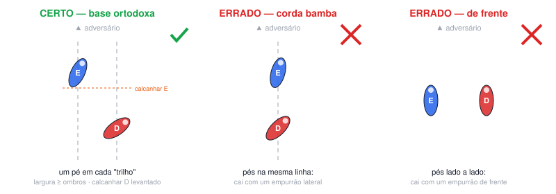
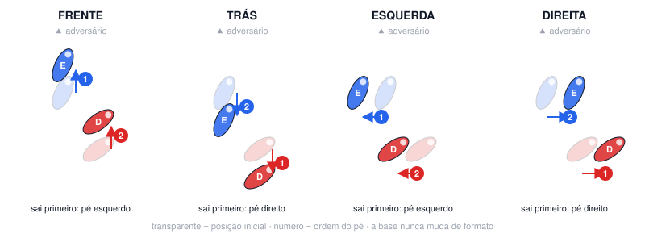

# Aula 01A — Base e guarda

**Semana 1 · Fase 1 — Fundação · Sessão solo de 60 min**

**Objetivo:** Montar a base ortodoxa e a guarda corretas, de forma automática, e dar os primeiros passos sem desmontá-las.

## Antes da aula: assistir

- [How to Shadow Box 101](https://www.youtube.com/watch?v=fWfsbL2ulj8) — Tony Jeffries (bronze olímpico 2008)
- [Basics of Boxing — Training for Beginners at Home](https://www.youtube.com/watch?v=kKDHdsVN0b8) — Tony Jeffries (bronze olímpico 2008)
- [Your Boxing Stance is Wrong](https://www.youtube.com/watch?v=e2S6-gwR0es) — Tony Jeffries (bronze olímpico 2008)

## A. Aquecimento (10 min)

- Corda: 3 × 2 min (30 s de descanso). Pulo básico com os dois pés, baixo e leve, na planta dos pés.
- Protocolo de ombro (~4 min): rotação externa deitado de lado 2×12 por braço · Y-T-W 1×8 de cada letra · flexão escapular 1×12 · alongamento de peitoral menor no batente 2×20 s por lado · círculos de braço.
- Mobilidade (2 min): rotação de quadril, tornozelo, agachamento profundo segurando 30 s, rotação torácica de quatro apoios.

## B. Técnica

### Montagem da base no espelho (5 min)

1. Fique em pé, com os pés juntos e relaxado.
2. Em 1 segundo, monte a base e a guarda.
3. Confira o checklist no espelho, relaxe e repita. Faça 20 repetições.

**Pontos-chave:** pé E à frente, um pé em cada "trilho" · calcanhar D levantado · mão D colada na bochecha · queixo baixo, cotovelos fechados

### Fita no chão e olhos fechados (5 min)

1. Monte a base e marque a posição dos dois pés com fita crepe.
2. Saia da posição, feche os olhos e monte a base de novo.
3. Abra os olhos e veja se os pés caíram nas marcas. Faça 10 repetições.

**Pontos-chave:** o corpo precisa "sentir" a base certa sem olhar

### Step-drag: frente e trás (5 min)

1. Faça 1 passo por vez: o pé da frente sai, o de trás acompanha.
2. Pare, confira a base e só então dê o próximo passo.
3. Faça 4 × 1 min, alternando frente e trás.

**Pontos-chave:** passos de 10–20 cm · pés raspando o chão · a cabeça não sobe nem desce

### Step-drag: esquerda e direita (5 min)

1. Para a esquerda, o pé E sai primeiro. Para a direita, o pé D sai primeiro.
2. Faça 4 × 1 min.

**Pontos-chave:** nunca cruzar os pés · nunca juntar os pés

## C. Shadowboxing (4 rounds de 2 min (1 min de descanso))

- R1: só movimentação nas 4 direções, guarda perfeita, olhar fixo num ponto à frente.
- R2: igual ao R1, mas os pés só podem andar dentro de um quadrado de 2 × 2 m.
- R3: movimentar → parar → 1 jab devagar → movimentar.
- R4: igual ao R3. Grave este round no celular.

## D. Força e condicionamento (12 min)

*Fase 1: aprender os movimentos (2 voltas, 45–60 s entre exercícios)*

- Agachamento goblet com halter: 10
- Flexão de braço (inclinada se precisar), cotovelos a ~45°: 8–12
- Remada unilateral com halter: 10 por lado (+1 série extra no braço esquerdo)
- Prancha: 30 s
- Isometria de pescoço com a mão (frente, trás, lados): 10 s cada

## E. Volta à calma (3 min): respiração lenta, alongamento leve, notas do ombro no diário (antes/depois) e 1 erro visto no vídeo.

## Foco para levar à aula em grupo

> A base nunca desmonta: os pés nunca ficam na mesma linha.

---
[← índice das aulas](README.md)
