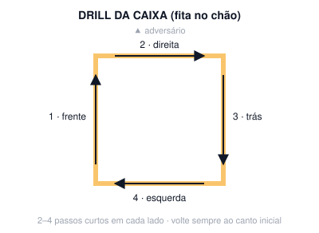

# Aula 01B — Jab parado

**Semana 1 · Fase 1 — Fundação · Sessão solo de 60 min**

**Objetivo:** Construir o jab com a mecânica certa: sem telegrafar, com volta rápida e com a guarda protegendo.

## Antes da aula: assistir

- [How to throw a jab](https://www.youtube.com/watch?v=odM78vAS86M) — Tony Jeffries (bronze olímpico 2008)
- [Freddie Roach teaching boxing basics](https://www.youtube.com/watch?v=uUTWcGol3CY) — Freddie Roach (Hall of Fame, treinador de Pacquiao)

## A. Aquecimento (10 min)

- Corda: 3 × 2 min (30 s de descanso). Pulo básico com os dois pés, baixo e leve, na planta dos pés.
- Protocolo de ombro (~4 min): rotação externa deitado de lado 2×12 por braço · Y-T-W 1×8 de cada letra · flexão escapular 1×12 · alongamento de peitoral menor no batente 2×20 s por lado · círculos de braço.
- Mobilidade (2 min): rotação de quadril, tornozelo, agachamento profundo segurando 30 s, rotação torácica de quatro apoios.

## B. Técnica

### Revisão da base (5 min)

1. Faça 10 montagens de base no espelho.
2. Faça 2 min de step-drag nas 4 direções.

**Pontos-chave:** o checklist da sessão 01A

### Jab parado, um detalhe por round (15 min)

1. Faça 5 rounds de 2 min (30 s de descanso), com 1 jab a cada 3–4 s, a 50–70% da velocidade.
2. Em cada round, foque em um item: (1) sem recuar a mão antes, (2) mão D colada no queixo, (3) volta mais rápido do que vai, (4) ombro E sobe e protege o queixo, (5) expire ("tss") em cada jab.

**Pontos-chave:** punho gira no fim · não travar o cotovelo (ombro E!) · a mão volta pelo mesmo caminho

## C. Shadowboxing (4 rounds de 2 min)

- R1: drill da caixa com a fita no chão (frente → direita → trás → esquerda).
- R2: jab parado + 1 passo para trás.
- R3: jab duplo (1-1) parado.
- R4: livre, com jab e footwork. Grave.

## D. Força e condicionamento (12 min)

*Fase 1: aprender os movimentos (2 voltas, 45–60 s entre exercícios)*

- Agachamento goblet com halter: 10
- Flexão de braço (inclinada se precisar), cotovelos a ~45°: 8–12
- Remada unilateral com halter: 10 por lado (+1 série extra no braço esquerdo)
- Prancha: 30 s
- Isometria de pescoço com a mão (frente, trás, lados): 10 s cada

## E. Volta à calma (3 min): respiração lenta, alongamento leve, notas do ombro no diário (antes/depois) e 1 erro visto no vídeo.

## Foco para levar à aula em grupo

> A mão de trás fica colada no rosto o tempo todo.

---
[← índice das aulas](README.md)
