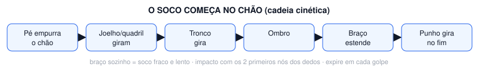
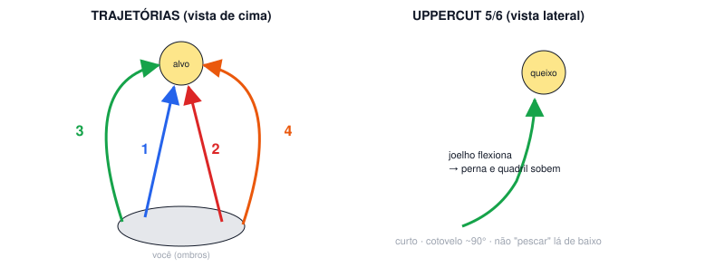

# Aula 02B — Direto (2) e 1-2

**Semana 2 · Fase 1 — Fundação · Sessão solo de 60 min**

**Objetivo:** Aprender o direto com o giro do pé de trás e do quadril, e juntá-lo ao jab.

## Antes da aula: assistir

- [How to Throw the Perfect Cross](https://www.youtube.com/watch?v=sK-6Ujp3KYY) — Tony Jeffries (bronze olímpico 2008)
- [Mitt Work Notes #15 — Throwing the Right Hand](https://www.youtube.com/watch?v=j3YJyXe57_0) — Freddie Roach (Hall of Fame)

## A. Aquecimento (10 min)

- Corda: 3 × 2 min (30 s de descanso). Pulo básico com os dois pés, baixo e leve, na planta dos pés.
- Protocolo de ombro (~4 min): rotação externa deitado de lado 2×12 por braço · Y-T-W 1×8 de cada letra · flexão escapular 1×12 · alongamento de peitoral menor no batente 2×20 s por lado · círculos de braço.
- Mobilidade (2 min): rotação de quadril, tornozelo, agachamento profundo segurando 30 s, rotação torácica de quatro apoios.

## B. Técnica

### Direto lento, um detalhe por round (10 min)

1. Faça 5 rounds de 1:30 a 50% da velocidade.
2. Itens, um por round: giro do calcanhar D para fora · quadril gira · mão E fica no rosto · cabeça não passa do joelho da frente · volta pela mesma linha.

**Pontos-chave:** o soco começa no chão

### 1-2 parado (10 min)

1. Primeiro lento, depois médio. Faça 4 × 2 min.

**Pontos-chave:** o 1 "abre" e o 2 "fecha" · as duas mãos voltam à guarda

## C. Shadowboxing (5 rounds de 2 min)

- R1–R2: 1-2 parado, lento.
- R3: 1 entrando, 2 parado.
- R4: 1-2 e passo para trás.
- R5: livre com jab, direto e footwork.

## D. Força e condicionamento (12 min)

*Fase 1: aprender os movimentos (2 voltas, 45–60 s entre exercícios)*

- Agachamento goblet com halter: 10
- Flexão de braço (inclinada se precisar), cotovelos a ~45°: 8–12
- Remada unilateral com halter: 10 por lado (+1 série extra no braço esquerdo)
- Prancha: 30 s
- Isometria de pescoço com a mão (frente, trás, lados): 10 s cada

## E. Volta à calma (3 min): respiração lenta, alongamento leve, notas do ombro no diário (antes/depois) e 1 erro visto no vídeo.

## Foco para levar à aula em grupo

> Direto com o giro do pé de trás e a mão esquerda no rosto.

---
[← índice das aulas](README.md)
