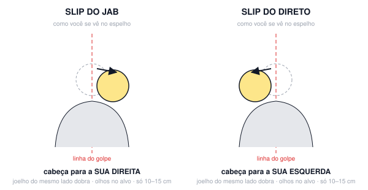
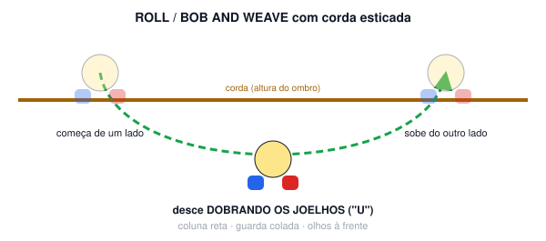

# Aula 06B — Slip e roll

**Semana 6 · Fase 2 — Arsenal · Sessão solo de 60 min**

**Objetivo:** Movimento de cabeça e tronco para sair da linha do golpe.

## Antes da aula: assistir

- [Slip the Jab — Teddy Atlas](https://www.youtube.com/watch?v=FHEv5EF91CY) — Teddy Atlas (treinador de campeão mundial)
- [Defense Notes #3 — Slip / Under](https://www.youtube.com/watch?v=-Qdn-BjKGxo) — Freddie Roach (Hall of Fame)
- [How to Defend Any Punch in Boxing](https://www.youtube.com/watch?v=ReD58z0jFJM) — Tony Jeffries (bronze olímpico 2008)

## A. Aquecimento (10 min)

- Corda: 3 × 2 min. Alterne os pés ("boxer skip") e faça 2 pulos rápidos a cada 30 s.
- Protocolo de ombro (~4 min), igual ao da fase 1.
- Mobilidade (1 min) + 1 round de 2 min de shadowboxing leve, só jab e footwork (revisão da fase 1).

## B. Técnica

### Slip sem soco (5 min)

1. Slip do jab (cabeça para a sua direita) e slip do direto (cabeça para a sua esquerda), no espelho.

**Pontos-chave:** só 10–15 cm · o joelho do mesmo lado dobra · olhos no alvo

### Slip + resposta (5 min)

1. Slip do jab e devolve um 2; slip do direto e devolve um 3.

### Roll na corda (10 min)

1. Estique uma corda na altura dos ombros e atravesse por baixo dela de um lado para o outro. Faça 4 × 2 min.

**Pontos-chave:** desça pelos joelhos, em "U" · a guarda fica colada

## C. Shadowboxing (5 rounds de 2:30)

- R1: slip, slip, 1-2.
- R2: roll + 3 ao subir.
- R3: 1-2 + slip + 2.
- R4: na corda, roll por baixo + 1-2 do outro lado.
- R5: livre.

## D. Força e condicionamento (12 min)

*Fase 2: força (3 voltas)*

- Afundo reverso com halteres: 8 por lado
- Flexão de braço: 8 (desenvolvimento unilateral leve só se o ombro esquerdo estiver com 0 de dor)
- Remada unilateral: 10 por lado (+1 série no esquerdo)
- Dead bug: 10
- Farmer walk com halteres pesados: 40 s

## E. Volta à calma (3 min): respiração lenta, alongamento leve, notas do ombro no diário (antes/depois) e 1 erro visto no vídeo.

## Foco para levar à aula em grupo

> Slip com os olhos no adversário.

---
[← índice das aulas](README.md)
