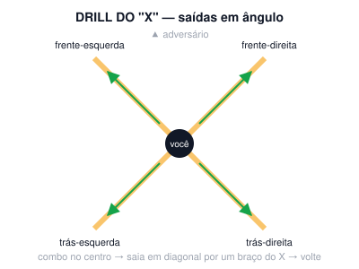

# Aula 09A — Ângulos

**Semana 9 · Fase 3 — Integração · Sessão solo de 60 min**

**Objetivo:** Nunca terminar uma combinação parado na frente do adversário.

## Antes da aula: assistir

- [Footwork: create angles with the shift drill](https://www.youtube.com/watch?v=inm9XaTwlRc) — Precision Striking (apoio (sem currículo de elite))
- [Lomachenko vs Rigondeaux (2017) — busca](https://www.youtube.com/results?search_query=Lomachenko+vs+Rigondeaux+2017) — luta de estudo (footwork e ângulos)
- [Thomas Hearns — jab e distância (busca)](https://www.youtube.com/results?search_query=Thomas+Hearns+jab+highlights) — luta de estudo (modelo para atleta alto e magro)

## A. Aquecimento (10 min)

- Corda: 3 × 2 min. Boxer skip, com 10 s de velocidade máxima a cada 40 s.
- Protocolo de ombro (~4 min).
- 1 round de 2 min de shadowboxing leve e livre.

## B. Técnica

### Saídas em ângulo (10 min)

1. 1-2 e passo lateral · 1-2-3 e pivô · 1-2 e diagonal para trás. Faça 5 × 2 min.

### Drill do X (10 min)

1. Combine no centro do X de fita, saia em diagonal por um dos braços e volte.

**Pontos-chave:** recuar em linha reta é proibido

## C. Shadowboxing (4 rounds de 3 min)

- R1: combina e sai em ângulo.
- R2: ele pressiona, você recua em ângulo e contra-ataca.
- R3: corpo e cabeça + ângulo.
- R4: livre. Grave.

## D. Força e condicionamento (12 min)

*Fase 3: potência e condicionamento*

- 3 voltas: 3 saltos verticais máximos + goblet 8 + flexão explosiva 6 (flexão normal se o ombro reclamar). Descanso de 60 s.
- Depois, 2 voltas de: 40 s burpee / 20 s descanso / 40 s mountain climber / 20 s descanso.

## E. Volta à calma (3 min): respiração lenta, alongamento leve, notas do ombro no diário (antes/depois) e 1 erro visto no vídeo.

## Foco para levar à aula em grupo

> Mude de ângulo depois de combinar.

---
[← índice das aulas](README.md)
