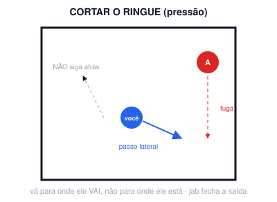

# Aula 10A — Pressão

**Semana 10 · Fase 3 — Integração · Sessão solo de 60 min**

**Objetivo:** Cortar o ringue e entrar com defesa, no estilo de Chávez, Frazier e Tyson.

## Antes da aula: assistir

- [Chávez vs Rosario (1987) — busca](https://www.youtube.com/results?search_query=Julio+Cesar+Chavez+vs+Edwin+Rosario+1987) — luta de estudo (pressão e corpo)

## A. Aquecimento (10 min)

- Corda: 3 × 2 min. Boxer skip, com 10 s de velocidade máxima a cada 40 s.
- Protocolo de ombro (~4 min).
- 1 round de 2 min de shadowboxing leve e livre.

## B. Técnica

### Cortar o ringue (10 min)

1. Dê passos laterais acompanhando o adversário imaginário e mantenha-o contra a parede, usando o jab para fechar a saída.

**Pontos-chave:** vá para onde ele vai, não para onde ele está

### Entrar com defesa (10 min)

1. Roll e 3b-3 · slip e 6-3-2.

## C. Shadowboxing (4 rounds de 3 min)

- Todos os rounds são de pressão, alternando cabeça e corpo.

## D. Força e condicionamento (12 min)

*Fase 3: potência e condicionamento*

- 3 voltas: 3 saltos verticais máximos + goblet 8 + flexão explosiva 6 (flexão normal se o ombro reclamar). Descanso de 60 s.
- Depois, 2 voltas de: 40 s burpee / 20 s descanso / 40 s mountain climber / 20 s descanso.

## E. Volta à calma (3 min): respiração lenta, alongamento leve, notas do ombro no diário (antes/depois) e 1 erro visto no vídeo.

## Foco para levar à aula em grupo

> Se o professor liberar, faça o primeiro sparring técnico leve (20–30% de força).

---
[← índice das aulas](README.md)
